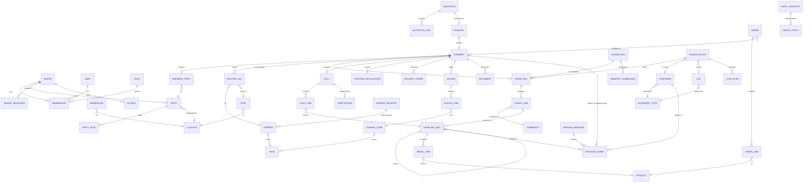

# Ternary Cargo — target architecture (full implementation)

Status: draft v0.2, 31 Oct 2026, Ternary Engineering Lead and Januli (chief architect). Januli's positions (`positions_solution_engineer.md`) and review (10 must-change, 10 should-change, 9 nits) are merged into the body; decisions are listed under 'Review notes (Januli) → Our responses'. Synthetic data only until Roshan approves otherwise. No repo changes have been made.

Source read (read-only clone): `RoshanGamage01/ternary-cargo`, branch `main`, commit `57b3327` (2026-10-31 16:38 Asia/Colombo, "Ternary Cargo UI-only prototype, research, screenshots and walkthrough deck"). **v2 lives unpushed on Roshan's computer**, so nothing of it is reflected here. The screen inventory (§0) and the mapping table (§9.1) must be re-checked against v2 after it is pushed, before any binding starts.

---

## 0. Prototype inventory

**Stack:** Next.js 14.2.35 (App Router; single catch-all route `app/[[...slug]]/page.tsx` passes `slug.join("/")` and the query string to `components/screens.tsx`, ~39 KB holding every screen; sub-views use query params `tab`, `step`, `mode`, `doc`, `state`, `done` — verified in the source), React 18, TypeScript 5, Tailwind 3.4, lucide-react icons, Playwright (screenshot script `shots.mjs`). No API layer, no state library, no auth, no tests. Desktop-only layout (fixed 240 px sidebar) — **not yet mobile-first**; the tally/verification screens in particular need a responsive pass.

**Mock data (`lib/data.ts`):** `tenants {id,name,plan,city}`; `shipments {ref,mode,doc,shipper,consignee,pol,pod,eta,status,tone}`; `customers` as string rows `[code,name,type,city,taxId,status]`; `masterTabs` (Customers, Carriers, Ports & Airports, Warehouses, Commodities & HS, Container types, Charges) as column/row string tables; `packages {no,desc,marks,declKg,dims}` (12 cartons). All strings, so the API must introduce real types (integer mm and grams, ISO dates, enum statuses; dims such as `"140×85×18"` become structured mm).

**Not in the prototype (new scope, not parity):** orders/order lines, products/GTIN, serials/SGTIN, SSCC handling units/pallets, EPCIS, a real 3D load planner (screens 19–20 show a hard-coded `pct = 74`/`63`), truck loading, carrier APIs, ETA logic and a PWA offline queue. M5–M6 items built on these are new scope, subject to open questions 7, 8 and 12.

**Mock fixes before any seed data (M0):**
- The BIA airport row reuses UN/LOCODE `LKCMB`; correct it to IATA `CMB` with its proper LOCODE entry, never reusing the seaport row.
- `customers`/`shipments` use real Sri Lankan and foreign company names and tax-ID-shaped values (e.g. `TIN 114002234`); the M0 seed generator replaces them with obviously fictitious parties and identifiers.
- Container types carry a single payload constant; replace with tare, max gross and payload per type (§5).
- `playwright` is in `dependencies` (used by `shots.mjs`); move it to `devDependencies`.
- Split `components/screens.tsx` per route before binding.

**Screens / routes (37 screenshots in `docs/screens/`):**

| # | Route | Screen |
|---|---|---|
| 01–02 | `/login`, `/tenant` | Login (SSO options), tenant select |
| 03 | `/dashboard` | KPIs, weekly volume by mode, exceptions |
| 04–10 | `/master-data?tab=…` | Customers (duplicate-TIN warning), carriers, ports/airports, warehouses, HS codes, container/ULD types, charges |
| 11 | `/quotations` | Quote → booking |
| 12 | `/shipments` | List, all modes |
| 13–18 | `/shipments/new` (4-step wizard) | Mode & parties, routing (sea/air), cargo lines, documents & review, created |
| 19–20 | `/consolidation` | Container stuffing (40' HC fill %), air ULD build-up (AKE under MAWB) |
| 21–24 | `/documents` | HBL, HAWB, commercial invoice, packing list previews |
| 25 | `/customs` | CUSDEC status, ASYHUB manifest due (72 h sea rule) |
| 26 | `/tracking` | Milestone timeline |
| 27 | `/arrival` | Arrival notice |
| 28–29 | `/unloading` | Devanning tally (per package, seal, weight, condition) |
| 30–31 | `/verification` | Discrepancy with photos, two-person sign-off |
| 32 | `/release` | Delivery order, gated on customs + verification + payment |
| 33 | `/billing` | Invoice, VAT, USD→LKR |
| 34 | `/reports` | Volume, dwell, clearance time, discrepancy rate, profitability |
| 35–37 | `/settings` | Users, roles & permissions, subscription plan |

---

## 1. Principles

1. Mobile-first and low-bandwidth: warehouse tally on cheap Android phones over patchy 4G; compressed JSON, cursor pagination, offline queue for tally.
2. Low cost: one modest VM per environment at the start; Postgres holds all durable state (outbox, events, search); Redis in the same compose only runs arq jobs (see ADR-1 in §7).
3. Reuse ternary-credit patterns, all confirmed in the credit repo reviews: FastAPI, Postgres with FORCE RLS via `app.tenant_id`, Alembic single head enforced in CI, append-only ledgers with a TRUNCATE-blocking trigger, the OpenAPI-generated TypeScript client, the gitleaks CI job, and the arq + Redis worker.
4. Every external system behind an adapter; every outbound effect through an outbox.
5. Synthetic data only until approved; no real customs, carrier or customer data.
6. British spelling and Ternary brand in UI, docs and generated documents.

## 2. Multi-tenancy

- **Model:** one Postgres, shared schema, `tenant_id uuid not null` on every tenant table; `ENABLE` + **FORCE ROW LEVEL SECURITY** on every tenant table.
- **Policy (read and write):** every policy has both `USING` and `WITH CHECK` on `tenant_id = NULLIF(current_setting('app.tenant_id', true), '')::uuid`. An unset or reset GUC yields NULL, so zero rows and rejected writes: genuinely fail-closed.
- **Per request:** the first statement of every transaction is `SELECT set_config('app.tenant_id', :tid, true)` (bound parameter, transaction-local, as in ternary-credit). Never `SET LOCAL` with string-built SQL. The tenant comes from the JWT/session claim after screen 02, never from a request body.
- **Roles (none has BYPASSRLS):**
  - `cargo_owner` — owns all objects, **NOLOGIN**;
  - `cargo_migrator` — runs DDL, member of `cargo_owner`; used only by Alembic;
  - `cargo_app` — API DML;
  - `cargo_worker` — arq jobs, sets the tenant per job;
  - `cargo_ops` — seeds global reference data, ops commands;
  - `cargo_readonly` — reports; still RLS-bound and must set the tenant. Cross-tenant ops reporting needs an explicit, audited path (a SECURITY DEFINER function with its own log), not a bypass role.
- **Tenant creation:** `SECURITY DEFINER create_tenant()` owned by `cargo_owner`, `SET search_path = public, pg_temp`, EXECUTE granted to `cargo_app` only, taking `pg_advisory_xact_lock` to enforce the plan's tenant/seat cap atomically (screen 37).
- **Memberships:** `memberships(user_id, tenant_id, role_id, branch_id)` — one user, many organisations (screen 02).
- **Global read-only reference tables** (`ref` schema, no `tenant_id`): UN/LOCODE ports and airports, HS nomenclature (WCO 6-digit; Sri Lankan national lines versioned by effective date and marked unverified, per `docs/research.md` §3), `ref.equipment_type` (ISO 6346 containers, IATA ULDs), currencies, and `ref.carrier_registry` (SCAC, IATA prefix). `REVOKE INSERT, UPDATE, DELETE` from `cargo_app` and `cargo_worker`; only the migrator or the ops seed job writes them.
- **Parties across tenants:** global `ref.party_registry` (legal name, SCAC/IATA prefix, GLN) for carriers, co-loaders and shipping agents; tenant-owned `tenant_party` (e.g. tenant `carrier` rows) referencing it, holding contracts, rate sheets, encrypted credentials and local codes (`CAR-01`, "FY26 rate sheet"). Customers (shipper/consignee) stay fully tenant-private even when two tenants serve the same company; the duplicate-TIN check (screen 04) is per tenant.
- **No cross-tenant co-loading in MVP.** If ever needed, it uses an explicit `shared_booking` grant table with its own policy, never a relaxed RLS policy.
- **Numbering:** `tenant_sequence(tenant_id, doc_type, period, next_val)` under RLS, incremented with `UPDATE … RETURNING` inside the business transaction; prefix configured per tenant (`TC-SEA-24118`, `CFL-HB-55120`). Invoice numbers are **gapless** because the row lock commits or rolls back with the invoice (VAT requirement to confirm); HBL and shipment refs may tolerate gaps. No per-tenant `SEQUENCE` objects (DDL per tenant, not RLS-scoped).
- **CI tests:**
  - read isolation: insert as A, read as B, expect 0;
  - write isolation: insert with B's `tenant_id` while A is set (rejected); update `tenant_id` to B (rejected); delete across tenants (0 rows);
  - pooled connection carries no tenant after commit;
  - **catalogue test:** fails if any table with a `tenant_id` column lacks ENABLE + FORCE or a policy with both USING and WITH CHECK;
  - GRANT test: app and worker cannot write `ref.*`.
- **Enterprise option later:** database-per-tenant on the same migrations, only for a tenant demanding physical isolation.

## 3. Data model

Conventions: `uuid` keys (UUIDv7 for index locality, generated in the application because PG16 has no native generator), `tenant_id` on all tenant tables, `numeric` for money, **integer grams** for weight, **integer mm** for dimensions, volume derived (display in kg, cm and m³ only), ISO 4217 currency, `timestamptz` UTC, soft status enums, `version int` for optimistic locking.

### 3.1 Master data
- `ref.party_registry` (global) and tenant `tenant_party` for carriers, agents and co-loaders (§2); `party` (tenant-private customers: shipper/consignee/notify/CHA/haulier roles via `party_role`), tax ID (TIN/VAT/TRN) with a unique-per-tenant normalised index plus fuzzy duplicate check (pg_trgm on name, phone) — screen 04's duplicate warning.
- `location` (address, geo point) and `port` (UN/LOCODE, type seaport/airport/ICD, terminals).
- `warehouse` (CFS, air shed, bonded; bays) → `location`.
- Carriers: `ref.carrier_registry` (SCAC, IATA prefix) + tenant `carrier` (`tenant_party`; contract ref, local code, credentials).
- `commodity` (HS code, description, hazmat UN number, class, packing group, temperature range).
- `product` (SKU, GTIN-8/12/13/14, dimensions, weight, stackability, orientation flags) — for load planning and GS1.
- `ref.equipment_type` (global; ISO 6346 size-type or IATA ULD; internal L/W/H mm, door W/H mm, tare g, max gross g, payload, reefer flag, nominal values marked "verify per carrier").
- `charge_code` and `rate` (basis, currency, validity, carrier/lane).
- `fx_rate` (date, pair, source; invoices snapshot the rate used).
- `tenant_sequence` (per-tenant numbering, §2).
- `product` (SKU, GTIN) — **new scope**, not in the prototype.

### 3.2 Operations
- `quotation` → `quotation_line`; accepted quote creates a `booking`.
- `order` (**new scope**; customer order / purchase order reference) → `order_line` (product, qty).
- `shipment` (mode: sea_fcl, sea_lcl, air, road, courier; direction; incoterm; status) with `shipment_party` (role), `routing_leg` (sequence, mode, POL/POD, carrier, vessel/voyage or flight, ETD/ETA planned/estimated/actual).
- `house_bill` (HBL/HAWB) and `master_bill` (MBL/MAWB); house ↔ master many-to-one for consolidation.
- `cargo_line` (package type, count, HS, gross/net weight, volume, marks).
- `container` (ISO 6346 number with check digit, type, seal numbers, VGM) and `uld` (type, serial, owner).
- `consolidation` (container or ULD) ↔ `house_bill` stuffing plan with fill % and weight.
- `handling_unit` (**new scope**; pallet/package) with **SSCC** (18 digits, GS1 company prefix + check digit), parent unit (nesting), dims, weight; `serial_item` (GTIN + serial = SGTIN) for serialised goods.
- `tally` and `tally_line` (per handling unit: seal, actual weight, condition, photo refs, offline client ID for idempotency; the PWA offline queue is new scope).
- `verification` (piece/weight/seal/marks checks, discrepancy; `signer_1`, `signer_2` with a DB `CHECK (signer_1 <> signer_2)` plus a permission check in a trigger, not just the UI).
- `customs_declaration` (CUSDEC ref, CHA party, status) and `manifest_submission` (ASYHUB ref, due-at, status).
- `delivery_order` (gates: customs released, verification signed, invoice paid or credit approved).
- `invoice` → `invoice_line` (charge code, qty, rate, currency, FX, VAT); `payment`.
- `document` (type HBL/HAWB/CI/PL/AN/DO/manifest; template version; storage key; hash; generated from snapshot data).
- `attachment` (photos, scans) in object storage, linked polymorphically.

### 3.3 Events (append-only), inbox and outbox
Events are used for **tracking and custody only**; orders, invoices and master data are plain CRUD with an audit trail.

- **`tracking_event`** — one append-only table, EPCIS 2.0-shaped, `subject_type ∈ {shipment, container, uld, handling_unit}` + `subject_id`:
  - what: `subject_refs` (SSCC, ISO 6346 container no., BL/AWB), `event_kind ∈ {Object, Aggregation, Transaction}`, `action ∈ {ADD, OBSERVE, DELETE}`;
  - when: `occurred_at timestamptz` (EPCIS eventTime) + `event_tz_offset` (eventTimeZoneOffset), and separately `recorded_at` (DB `now()`);
  - where: `read_point`, `biz_location` (UN/LOCODE, terminal, warehouse GLN);
  - why: CBV `biz_step` and `disposition`;
  - plus `source` (manual, asyhub, dcsa, aggregator, system), `source_event_id`, `idempotency_key`, `corrects_event_id`, `actor_user_id`, `payload jsonb`, `tenant_id`.
- **IDs only, no PII:** `payload` and actor fields hold IDs (party_id, user_id, attachment_id) and non-personal facts only. Names, phones, tax IDs, driver details (screen 32) and photos live in mutable tables, so they can be erased or minimised under the PDPA.
- **Append-only:** INSERT only; UPDATE/DELETE/TRUNCATE revoked and blocked by trigger (ternary-credit 0007 pattern). Corrections are new events referencing `corrects_event_id`, never updates.
- **No partitioning in MVP.** A unique index on a partitioned table must include the partition key, which would break global idempotency; revisit above ~50M rows.
- **Idempotency:** `UNIQUE (tenant_id, source, idempotency_key)`; key = provider event ID, else `sha256(source|subject|biz_step|occurred_at|location)`. Ingest is `INSERT … ON CONFLICT DO NOTHING`, so a carrier event arriving by both webhook and poll is stored once.
- **Inbox:** raw provider payloads go to `inbound_message` (tenant, provider, received_at, body), **scrubbed of PII** on ingest, retained **90 days**, then deleted by a retention job. Events are derived from it.
- **Ordering and rebuilds:**
  - projections order by `occurred_at`, then `recorded_at`, then `id`, never by arrival;
  - a late event recomputes that aggregate's projection (tens of events per shipment);
  - projections (`shipment_status`, `container_status`: milestone, location, last event, ETA band) are disposable; `rebuild_projection(aggregate)` is an ops command (`POST /ops/projections/rebuild`), and a **CI test asserts rebuild == incremental result**;
  - future-dated events beyond a tolerance (e.g. 15 minutes after allowing the offset) are quarantined, not projected.
- **Milestone mapping** (screen 26 `Tracking()`, 10 milestones) — illustrative, finalised in M4:

| Milestone | event_kind / action | biz_step | disposition | Sea (DCSA) / air (Cargo-IMP) source codes |
|---|---|---|---|---|
| Booking confirmed | Transaction ADD | `booking` (custom) | `active` | DCSA booking / air BKD |
| Cargo received at origin | Object OBSERVE | `receiving` | `in_progress` | DCSA gate-in / RCS |
| Container stuffed · seal / ULD built | Aggregation ADD | `loading` | `sealed` | DCSA stuffed (STUF) |
| Departed origin | Object OBSERVE | `departing` | `in_transit` | DCSA DEPA (vessel) / DEP |
| Transhipment | Object OBSERVE | `arriving`/`departing` | `in_transit` | DCSA ARRI/DEPA at T/S port |
| Arrived destination | Object OBSERVE | `arriving` | `in_transit` | DCSA ARRI / ARR, RCF |
| Customs cleared | Object OBSERVE | `inspecting` | `released` (customs) | ASYHUB/manual |
| Devanned / tallied | Aggregation DELETE + Object OBSERVE | `unloading` | `in_progress` | manual tally |
| Verified (discrepancy) | Object OBSERVE | `inspecting` | `damaged` / `conformant` | manual (screens 30–31) |
| Delivered / released | Object OBSERVE | `departing` → `accepting` | `delivered` | manual DO / DLV |

  One mapping table per source turns provider codes into these fields; DCSA codes for sea, Cargo-IMP/Cargo iQ codes (RCS, RCF, NFD, DLV) for air only.
- **Outbox:** `outbox(id, tenant_id, topic, payload, idempotency_key, created_at, locked_until, attempts, next_attempt_at, processed_at, dead_at)` written in the same transaction as the domain change; see §4.1 for dispatch.

### 3.4 ER diagram

## 4. Integrations

### 4.1 Pattern
- **Adapter per external system** behind a port interface (`ManifestGateway`, `TrackingProvider`, `EpcisRepository`, `NotificationSender`). Each has a `Fake` adapter (synthetic, deterministic) used in dev, CI and the demo; real adapters behind a per-tenant feature flag and per-tenant credentials (encrypted, never in logs).
- **Outbox → dispatcher (at-least-once):** an arq worker claims rows with `SELECT … FOR UPDATE SKIP LOCKED` and sets a lease `locked_until = now() + interval`; a stale lease is reclaimed by the next sweep. It calls the adapter through an anti-corruption layer (internal model translated only at the edge), sending the row's `Idempotency-Key`; consumers are idempotent. Retries use exponential backoff with jitter; after N attempts the row is dead-lettered (`dead_at`), with an ops replay command; a retention job deletes processed rows after 30 days. Outcomes are recorded as events.
- **Inbound:** `POST /webhooks/{provider}` verifies the signature (§8), writes the scrubbed raw payload to `inbound_message` (90-day retention) and returns 2xx, including for duplicates; an arq job maps it into `tracking_event` idempotently (§3.3). Polling runs as arq cron jobs into the same path.

### 4.2 ASYHUB (Sri Lanka Customs)
Public facts (from `docs/research.md`, customs.gov.lk): since 7 May 2025 cargo manifests must be lodged **only via ASYHUB** (UNCTAD); it covers port-call management, manifest lodgement (import/export/transhipment) and BL-type verification; ASYCUDA World stays for vessel registration, clearance and CUSDEC (lodged by Customs House Agents). Sea inward manifests are due 72 h before arrival at the first Sri Lankan port (Electronic Sea Cargo Reporting Regulations No. 1 of 2014). Air advance e-manifest regulation was drafted but not published.

**Unknowns (must be confirmed with Sri Lanka Customs / UNCTAD before any real build):**
- Whether ASYHUB exposes a machine API for third-party software, or only a web portal and file upload.
- Message format (UN/EDIFACT CUSCAR, XML, JSON, or an ASYHUB-specific schema) and version.
- Authentication model (per-agent certificates, user accounts, digital signatures), and whether software vendors need accreditation.
- Test/sandbox environment availability, and SLA/acknowledgement semantics (sync ack vs async status).
- Whether house-level (HBL) lines are lodged by the forwarder/NVOCC separately from the carrier's master manifest.
- Any API for CUSDEC status from ASYCUDA World, or CHA-only access.

**Phased approach** behind a `CustomsPort` interface (credentials per tenant, envelope-encrypted, §8): (0) mock adapter for tests; (1) generate an ASYHUB-ready manifest file/report from shipment data for manual upload (no integration, lowest risk); (2) status tracking by manual entry; (3) ASYHUB sandbox if UNCTAD / Sri Lanka Customs grants access; (4) live. The 72 h deadline is a computed SLA on the projection (screen 25 "due in 18 h").

### 4.3 Carrier tracking
- **Aggregators** (e.g. project44, Vizion, Terminal49, Portcast, Shippeo for sea; Cargoai/Track-Trace style services for air; DHL/FedEx/UPS APIs for courier): one integration, normalised events, webhooks; cost per tracked container/AWB. Prices and coverage to be verified.
- **Direct carrier APIs** (Maersk, ONE, Hapag-Lloyd etc. via DCSA Track & Trace standard; airline APIs or IATA Cargo-XML/ONE Record): free or cheap, but many integrations and uneven coverage.
- **Recommendation:** start with a `TrackingProvider` interface, the Fake adapter, plus manual milestone entry; then one aggregator for sea and air on a per-tenant paid add-on (cost passed through), and DCSA-compliant direct adapters for the top two or three lines used by pilot tenants. Webhooks preferred; polling fallback at adaptive intervals (e.g. every 6 h at sea, hourly within 48 h of ETA) to control cost.
- Events are normalised to the CBV fields in §3.3 through one mapping table per source: DCSA Track & Trace event codes for sea; Cargo-IMP / Cargo iQ status codes (BKD, RCS, DEP, ARR, RCF, NFD, DLV) for air only.

### 4.4 GS1
- **Identifiers:** GTIN on products, SSCC on handling units (pallets/packages), SGTIN for serials, GLN for locations optional. Check-digit validation in the domain layer.
- **Barcodes:** GS1-128 logistics labels with SSCC (AI 00) and optional GTIN/weight AIs, generated server-side as SVG/PDF (small, printable on thermal printers); GS1 DataMatrix/QR (GS1 Digital Link URIs) for serial items. Scanning on mobile via the browser camera (BarcodeDetector API with a WASM fallback such as ZXing) — no native app needed in phase 1.
- **EPCIS 2.0:** export ObjectEvent/AggregationEvent (packing, stuffing), TransactionEvent (BL/invoice), with bizStep/disposition CBV values, as JSON-LD from the event log; optional capture endpoint for trading partners later. GS1 company prefix per tenant (tenants must own their prefix; synthetic prefix in demo).

## 5. 3D load-planning engine

**New scope:** the prototype shows only a hard-coded fill % (`pct = 74`/`63`, screens 19–20) and weight/CBM totals. Whether it is in MVP is open question 12.

- **v1 scope:** ISO containers only — 20GP (22G1), 40GP (42G1), 40HC (45G1), 20RF/40RH (22R1/45R1). ULD contours come in v2. Truck axle loads wait until RDA limits are confirmed (open question 8).
- **Inputs/outputs:** handling units in **integer mm and grams** (allowed orientations, stackable, max stack load, fragile, hazmat UN number/class, stop order) + a `ref.equipment_type` + params → placements (x, y, z, rotation), volume and weight utilisation % computed from the placements (replacing the hard-coded `pct`), centre of gravity, front/rear weight split, violations.
- **Algorithm `lp-ep-ffd/1`:** extreme-point placement (Crainic, Perboli, Tadei) with first-fit-decreasing ordering. Sort key: **stop order desc (LIFO) first**, then non-stackable last, then volume desc, weight desc. Pallets (rigid floor items with SSCC) are placed first; loose cartons fill around them. Each item tries its allowed orientations at each extreme point, scored by lowest z, then deepest x, then y. Layer/skyline building is the fallback for homogeneous palletised loads.
- **Local search:** optional swap/reinsert over the ordering using a **seeded** PRNG, **capped at ~2 s**; objective = utilisation − penalties. No unseeded "best of several runs".
- **Hard constraints:** internal L×W×H **and door aperture**; payload (max gross − tare); orientation lock (this-way-up = z rotation only); stackable / max stack load; **fragile = nothing on top**; **support ratio ≥ `params.min_support_ratio`** of the base area (per-plan parameter, default 0.75); LIFO door path for multi-drop; reefer usable height below the load line with airflow clearance.
- **Soft/advisory:** CoG within ±5–10 % of the centre; **front/rear weight split as the axle-load proxy**, flagged against tolerance.
- **Hazmat: flagged, not solved, in v1.** Items with UN numbers (e.g. UN3480) and incompatible classes raise a violation for a human; no automatic IMDG segregation.
- **Determinism:** `plan(items, equipment_spec, params, algo_version, seed)` is a pure function with no I/O, stable sort, fixed seed and integer units. `input_hash` = sha256 of the canonical JSON of items, equipment spec, **all params including `min_support_ratio`**, and seed, so changing the ratio changes the hash and the golden tests catch it. `load_plan` stores `algo_version`, `input_hash`, `seed`, `params`, utilisation, CoG, violations and placements; results are cached by `input_hash` + `algo_version` and are immutable (re-plan = new row). **Golden-file tests** pin outputs per version (credit's `scorer_version` / `points_table_hash` pattern).
- **CP-SAT (OR-Tools):** a separate versioned solver only for loads **under ~100 items** or with heavy hard side-constraints, time-limited and warm-started from the heuristic. Never the default.
- **Boundary and jobs:** `loadplan` is an **in-repo package** of the modular monolith (pure, no DB access), not a separate service. `POST /load-plans` → `202` + job ID (enqueued via the outbox, run by arq, 10 s total budget); `GET /load-plans/{id}` to poll.
- **UI:** `@react-three/fiber` (three.js), lazy-loaded, colours placements by stop/HBL with a step-through load sequence and violation highlights; read-only in v1. A 2D top/side view is the default on mobile and low bandwidth. Results are labelled heuristic and need human confirmation before stuffing.
- **Validation:** synthetic instances plus published sets (Bischoff & Ratcliff).

## 6. ETA model

- **Phase A — rules baseline (MVP):** ETA = carrier schedule ETA (vessel/voyage or flight) or configured lane transit; departure delays propagate; a carrier-supplied ETA overrides; per-step dwell defaults (transhipment, discharge→CFS, customs, devanning) from tenant history. Output `eta`, `eta_source` and a **confidence band** (`eta_early`/`eta_late`, labelled high/medium/low): high and narrow when carrier-confirmed, decaying and widening with the age of the last event. Each re-estimate is appended to `eta_estimate` for audit and backtests, recomputed by the worker on every new event.
- **Phase B — ML (gated on approved real data):** a gradient-boosted residual model (delay vs schedule) with quantile outputs for the band, using lane, carrier/service, transhipments, season and holidays, schedule, latest milestone lateness and dwell features; it needs roughly 6–12 months of real tenant history. It is evaluated by MAE and P90 error on time-based splits and ships only if it beats both the carrier ETA and Phase A. Synthetic data is for pipeline tests only.

## 7. Stack choice

| Layer | Choice | Rationale |
|---|---|---|
| Frontend | **Next.js pinned to 14.2.x** + React 18 + TypeScript + Tailwind | Keeps the prototype; upgrade Next as a separate task, never during binding. Add responsive layouts, TanStack Query, PWA offline queue for tally (new scope) |
| API contract | FastAPI OpenAPI → `openapi-typescript` → committed **`schema.ts`**; CI regenerates and fails on diff | Contract first; credit pattern plus its schema-drift follow-up |
| Mocks | Only behind `NEXT_PUBLIC_USE_MOCKS === "true"` (strict compare); CI mock-leak check | Credit pattern |
| Backend | Python 3.12, FastAPI, Pydantic v2, SQLAlchemy 2/psycopg; **modular monolith** `apps/api`, `apps/worker`, `apps/web`, packages `tenancy`, `masterdata`, `shipments`, `tracking`, `loadplan`, `docs`, `customs`, `billing` | Same as credit; Python suits load planning, OR-Tools and ML. No microservices, no Kubernetes |
| DB | PostgreSQL 16, FORCE RLS, pg_trgm; **no PostGIS** (UN/LOCODE + lat/lon; the screen 26 map is decorative) | Add PostGIS only for geofencing, AIS or distance-based ETA |
| Migrations | Alembic, single head enforced in CI, run as `cargo_migrator` | Credit pattern |
| Jobs | **Postgres outbox + arq on Redis** (ADR-1) | See below |
| Files | S3-compatible storage (Linode Object Storage or Cloudflare R2), short-TTL signed URLs, sha256 recorded | Cheap; photos compressed client-side to WebP ≤ 300 KB |
| Documents | **WeasyPrint** HTML→PDF in the worker | Branded, no headless browser |
| Auth | Email + password/TOTP and magic link first; Google/Microsoft SSO later (screen 01) | Low cost |
| Deploy | Docker Compose + nginx, services bound to 127.0.0.1, one VM per environment | Credit pattern |
| CI | ruff, mypy, pytest, RLS catalogue/leak/GRANT tests, projection rebuild test, load-plan golden tests, schema regen-and-diff, mock-leak, Playwright screenshot parity (`shots.mjs`), gitleaks | Credit pattern |

**ADR-1 — job queue (decided 31 Oct 2026):** the Postgres **outbox** is the source of dispatch (transactional with domain writes, drained with SKIP LOCKED and leases, §4.1); **arq + Redis** executes jobs (load plans, PDF rendering, ETA recompute, polling cron, adapter calls). Reasons: ternary-credit already runs arq + Redis, so worker code, deploy, runbooks and CI are reused; Redis runs in the same compose at near-zero cost; arq gives retries, timeouts and cron for free. Redis holds no source of truth — if it is lost, the outbox re-enqueues. Rejected: Postgres-only queue (we would rebuild retries, scheduling and timeouts and lose credit reuse); Kafka/Redpanda (no need below ~1k events/s).

## 8. Security, observability, cost

**Security**
- RLS fail-closed with USING + WITH CHECK, role split and CI tests (§2).
- RBAC with the permission matrix (screen 36); separation of duties for verification sign-off enforced in the database (`CHECK (signer_1 <> signer_2)` plus a permission check) and for DO release.
- **Integration credentials** (carrier, aggregator, ASYHUB): envelope encryption per tenant with the key outside the database (env, KMS or sops), never readable by `cargo_readonly`, rotatable, redacted in logs and Sentry.
- **Webhooks:** HMAC-SHA256 over the raw body, constant-time compare, signed timestamp with a replay window of ≤ 5 minutes, per-provider secrets, 2xx on duplicates. Providers that cannot sign: mTLS, or a secret URL plus an IP allowlist.
- **Uploads:** short-TTL signed URLs with content-type and size limits; MIME sniffing and malware scanning on photos.
- **PII:** IDs only in events (§3.3); raw inbox payloads scrubbed and kept 90 days. **PII inventory** (owner, purpose, retention, erasure path): party contact names, phones, emails and tax IDs (screen 04); user accounts (screen 35); driver name, phone and licence on DOs (screen 32); damage photos that may show people or plates (screen 30); signer identities (screen 31). Sri Lanka PDPA No. 9 of 2022 review before any real data.
- Secrets never in the repo or logs (gitleaks); per-IP and per-tenant rate limits; TLS everywhere; encrypted backups with a monthly restore test; dependency scanning.

**Observability (single VM)**
- Structured JSON logs with `tenant_id`, `request_id`, `correlation_id` (no PII, no secrets).
- Sentry, or self-hosted GlitchTip, for errors; uptime checks.
- Business alerts: manifest due within 24 h and not lodged, dead-lettered outbox rows, quarantined events.
- Metrics (OpenTelemetry/Prometheus/Grafana) only once there is more than one host.

**Cost (indicative, to verify):** pilot on one 4–8 GB VM (~USD 24–48/month) running Postgres, Redis, API, worker and web; object storage (~USD 5); backups. Aggregator tracking billed per shipment and passed through. Target infra under USD 5 per tenant per month at 50 tenants. Low-bandwidth budget: < 300 KB JS on first load of mobile screens, compressed responses, ≤ 50 rows per page.

## 9. Phased build plan

All phases use synthetic data and fake adapters until Roshan approves otherwise. **Contract first:** a screen's endpoints are defined as FastAPI models, `schema.ts` is regenerated and committed (CI fails on diff), then the screen flips from mock to API behind a **per-screen feature flag**, with Playwright screenshot parity as acceptance. Mocks stay only behind `=== "true"`. Re-check this table against v2 once it is pushed.

**Phase alignment (Januli P0–P6 → M0–M9):** P0 = M0; P1 = M1 + M2; P2 = M3; P3 = M4 (tracking) + dashboard from M8; P4 = M6 consolidation + M4 documents; P5 = M5 + M6 customs + M7 DO + arrival notice; P6 = M7 billing + M8 reports + settings. M9 (real integrations) stays approval-gated. M labels are canonical; P labels are aliases.

### 9.1 Screen-to-endpoint mapping

| Screen (route) | Endpoints (prefix `/api/v1`) | Phase |
|---|---|---|
| 01 Login (`/login`) | `POST /auth/login`, `POST /auth/refresh`, `POST /auth/logout` | M1 |
| 02 Tenant select (`/tenant`) | `GET /me/tenants`, `POST /auth/switch-tenant` | M1 |
| 35–36 Users, roles (`/settings`) | `GET/POST/PATCH /users`, `GET /roles`, `PUT /roles/{id}/permissions` | M1 |
| 04–10 Master data (`/master-data`) | `GET/POST/PATCH /parties` (+ `GET /parties/duplicates?tin=&name=`), `/carriers`, `/ports`, `/warehouses`, `/commodities`, `/equipment-types`, `/charge-codes`, `/rates`, `/products` | M2 |
| 12 Shipments list (`/shipments`) | `GET /shipments?mode=&status=&q=&cursor=` | M3 |
| 13–18 Wizard (`/shipments/new`) | `POST /shipments` (draft), `PATCH /shipments/{id}`, `PUT /shipments/{id}/legs`, `PUT /shipments/{id}/cargo-lines`, `POST /shipments/{id}/confirm` (issues HBL/MBL numbers) | M3 |
| 11 Quotation (`/quotations`) | `GET/POST /quotations`, `POST /quotations/{id}/price`, `POST /quotations/{id}/accept` → booking | M3 |
| 26 Tracking (`/tracking`) | `GET /shipments/{id}/events`, `POST /shipments/{id}/milestones` (manual), `GET /shipments/{id}/eta` | M4 |
| 21–24 Documents (`/documents`) | `POST /shipments/{id}/documents` (type), `GET /documents/{id}` (PDF signed URL) | M4 |
| 27 Arrival notice (`/arrival`) | `POST /shipments/{id}/arrival-notice`, `GET /arrival-notices` | M4 |
| 28–29 Unloading (`/unloading`) | `POST /tallies`, `PUT /tallies/{id}/lines/{unit}` (idempotent, offline-safe), `POST /attachments` (signed upload), `POST /tallies/{id}/complete` | M5 |
| 30–31 Verification (`/verification`) | `POST /tallies/{id}/verification`, `POST /verifications/{id}/sign` (two users) | M5 |
| 19–20 Consolidation (`/consolidation`) | `GET/POST /consolidations`, `PUT /consolidations/{id}/house-bills`, `POST /load-plans` (202), `GET /load-plans/{id}` | M6 |
| 25 Customs (`/customs`) | `GET /customs/declarations`, `PATCH /customs/declarations/{id}`, `GET /manifests/due`, `POST /manifests/{id}/export` (ASYHUB-ready file) | M6 |
| 32 Delivery order (`/release`) | `GET /shipments/{id}/release-gates`, `POST /delivery-orders` | M7 |
| 33 Billing (`/billing`) | `POST /shipments/{id}/invoices` (from charges), `GET /invoices`, `POST /invoices/{id}/payments`, `GET /fx-rates` | M7 |
| 03 Dashboard (`/dashboard`) | `GET /dashboard/kpis`, `GET /dashboard/exceptions` | M8 |
| 34 Reports (`/reports`) | `GET /reports/{volume,dwell,clearance,discrepancy,profitability,carriers}` (CSV export) | M8 |
| 37 Plan (`/settings`) | `GET /subscription`, `GET /usage` | M8 |
| — GS1 (new scope) | `POST /handling-units` (SSCC allocate), `GET /handling-units/{id}/label`, `GET /epcis/events` | M5–M6 |
| — Inbox | `POST /webhooks/{provider}` (HMAC-verified) | M4 |
| — Ops | `POST /ops/projections/rebuild`, `POST /ops/outbox/replay` | M4 |

### 9.2 Milestones and exit criteria

| Milestone | Scope | Exit criteria |
|---|---|---|
| M0 Foundations (P0, 1–2 wk) | Monorepo `apps/api`, `apps/worker`, `apps/web`; split `screens.tsx` per route; mock fixes and playwright to devDeps (§0); mocks gated `=== "true"`; Alembic baseline; role split, policies, `create_tenant`, `tenant_sequence`; `tracking_event`, inbox, outbox; arq + Redis; `schema.ts` regen-and-diff; synthetic seed generator; demo compose | CI green incl. RLS catalogue/read/write leak, GRANT, schema-diff, mock-leak and gitleaks; single Alembic head; seeded demo up; no real names or tax IDs anywhere |
| M1 Identity & tenancy (P1) | Screens 01, 02, 35, 36 | Login, tenant switch, RBAC enforced server-side; cross-tenant tests pass; Playwright flow green |
| M2 Master data (P1) | Screens 04–10 | CRUD with validation (UN/LOCODE, ISO 6346, HS format, TIN duplicate check); mock tables removed |
| M3 Quote & shipment core (P2) | Screens 11–18 | Quote → booking → shipment for all modes; HBL/MBL numbering per tenant; events written |
| M4 Visibility & documents (P3/P4) | Screens 21–24, 26, 27 | Branded PDFs from snapshots; manual milestones + Fake tracking adapter via outbox; rules ETA shown |
| M5 Warehouse mobile (P5) | Screens 28–31 incl. offline tally. GS1 SSCC labels are **new scope, gated on open questions 7 and 8 (and 12)**, like the planner, and are not acceptance criteria | Works on a mid-range Android over throttled 3G; offline tally syncs idempotently; two-person sign-off enforced; photos ≤ 300 KB |
| M6 Consolidation & customs (P4/P5) | Screens 19, 20, 25 | `lp-ep-ffd/1` golden tests pass; jobs return within 10 s (local search ≤ 2 s) on 200-unit synthetic ISO-container cases with hard constraints met and hazmat flagged; ASYHUB-ready export validated against the confirmed format (or flagged unconfirmed) |
| M7 Release & billing (P5/P6) | Screens 32, 33 | DO gated on customs, verification and payment; VAT and FX correct on test vectors |
| M8 Insight & SaaS (P3/P6) | Screens 03, 34, 37 | KPIs reconcile with event log; reports export CSV; plan/seat limits enforced |
| M9 Real integrations (needs approval) | Aggregator tracking, direct carriers, ASYHUB adapter if available, EPCIS export, ML ETA | Signed agreements, sandbox tests, security review, Roshan's written go-ahead for any real data |

## 10. Risks and open questions

**Risks**
- ASYHUB may offer no third-party API; mitigated by file export and manual workflow.
- Tracking aggregator cost could exceed per-tenant margin; mitigated by add-on pricing and adaptive polling.
- Prototype is desktop-only; the mobile tally needs a redesign, not just binding.
- Prototype v2 is unpushed on Roshan's computer; the inventory and mapping must be re-checked after the push.
- Hot-row contention on `tenant_sequence` under bulk import (acceptable at MVP scale).
- Redis is a second process; it holds no source of truth (ADR-1).
- ML ETA has no real data; the rules baseline may be all that ships for a long time.
- Load-planning outputs are heuristic and advisory: hazmat is only flagged and axle load only proxied by weight split until validated.
- Shared-schema multi-tenancy relies on RLS discipline; one missing policy leaks data (CI leak tests are mandatory).

**Open questions**
1. Does ASYHUB expose an API for forwarders/NVOCCs, in what format, with what accreditation and sandbox? Who at Sri Lanka Customs do we ask?
2. Is CUSDEC/ASYCUDA World status in scope, or does the CHA workflow stay manual?
3. Which tracking aggregator(s) and carriers do the pilot tenants actually use, and who pays per-shipment fees?
4. Target pilot tenants and modes first (sea LCL/FCL vs air vs road)?
5. Is accounting in scope (GL, receivables), or do we export to existing systems (e.g. QuickBooks, Xero, local ERPs)?
6. Data residency: must data stay in Sri Lanka/region, and does PDPA require a local host?
7. GS1: will tenants have their own GS1 company prefixes, and is EPCIS needed by any real trading partner?
8. Road axle limits and hazmat rules to apply (Sri Lanka RDA, IMDG, IATA DGR) — who validates?
9. SSO providers required at launch (Google, Microsoft)?
10. Where is v2 being built (branch/repo), and when does Roshan's UI approval land, so binding starts on the right commit?
11. Hosting: same Linode as the ternary-credit demo, or a separate VM?
12. (Januli) Are the 3D load planner, GS1/SSCC and pallets/serials in MVP? None is in the prototype.
13. (Januli) Must invoice numbering be gapless under Sri Lankan VAT rules? (Designed gapless anyway.)
14. (Januli) ASYHUB access: third-party sandbox/API, or file export only? (See Q1.)
15. (Januli) Which tracking aggregator vendor, at what cost per container/AWB, and is it acceptable?
16. (Januli) Is event volume well below Kafka territory (assumed < 100k events/day/tenant)?
17. (Januli) Nominal container dimensions need verifying per carrier.

## Review notes (Januli)

_Reviewed 31 Oct 2026 against `ternary-cargo@57b3327` (read-only), the ternary-credit patterns, and `positions_solution_engineer.md`. Ordered by priority within each group._

### Must-change

1. **§2 Request path: GUC scope and fail-closed are wrong as written.**
   - **Issue:** `SET LOCAL app.tenant_id` can't take a bound parameter, so it invites string-built SQL. "Missing GUC = zero rows" is also false: `current_setting('app.tenant_id')` raises when the setting is unset, and `''::uuid` raises on reset.
   - **Fix:** use `SELECT set_config('app.tenant_id', :tid, true)`, transaction-local as in ternary-credit, issued as the first statement of every transaction. Write the policy as `tenant_id = NULLIF(current_setting('app.tenant_id', true), '')::uuid` so it really fails closed (NULL gives zero rows). Add a test showing a pooled connection carries no tenant after commit.
2. **§2 Policies: write-side isolation is missing.**
   - **Issue:** only `USING` is implied.
   - **Fix:** every policy gets `USING` and `WITH CHECK` on the same predicate, plus `ENABLE` and `FORCE` on every tenant table. Extend the CI leak suite (§2 Tests) beyond insert-as-A/read-as-B to cover:
     - insert with a foreign tenant_id (expect rejection);
     - update tenant_id to B (expect rejection);
     - delete across tenants;
     - a catalogue test that fails if any table with a `tenant_id` column lacks FORCE or a policy.
3. **§2 Roles: the split doesn't match ternary-credit, and tenant creation is undefined.**
   - **Issue:** `cargo_owner` is "migrations only", which merges owner and migrator, so the table owner also runs DDL in CI and prod. Nothing says how a tenant row is created when the app role is RLS-bound.
   - **Fix:**
     - Use `cargo_owner` (owns objects, NOLOGIN), `cargo_migrator` (DDL, member of owner), `cargo_app`, `cargo_worker` and `cargo_ops`/`cargo_readonly`. None of them has BYPASSRLS.
     - Tenant creation goes through a `SECURITY DEFINER create_tenant()` owned by owner, with `SET search_path = public, pg_temp`, EXECUTE granted to `cargo_app` only, and an advisory lock for the plan cap (screen 37).
     - Note that `cargo_readonly` (reports) is still RLS-bound and must set the tenant. Cross-tenant ops reporting needs an explicit, audited path.
4. **§2/§3 Per-tenant numbering is missing.**
   - **Issue:** M3 promises "HBL/MBL numbering per tenant", but no mechanism is specified. Postgres `SEQUENCE` objects aren't RLS-scoped and would need DDL per tenant.
   - **Fix:** add a `tenant_sequence(tenant_id, doc_type, period, next_val)` table under RLS, incremented with `UPDATE … RETURNING` in the business transaction. Invoice numbers must be gapless (VAT; confirm). HBL and shipment refs may tolerate gaps. The prefix is configured per tenant (prototype refs look like `TC-SEA-24118` and `CFL-HB-55120` in `lib/data.ts`).
5. **§3.3/§4.1 Event idempotency is undefined, and monthly partitioning breaks it.**
   - **Issue:** dedup exists only in `inbound_message` by provider message ID. Polling has no message ID, and the same carrier event arrives by both webhook and poll. A `UNIQUE` index on a partitioned `event` table must include the partition key, so a global `(tenant_id, source, idempotency_key)` uniqueness can't be enforced.
   - **Fix:**
     - Add `idempotency_key` with `UNIQUE (tenant_id, source, idempotency_key)`, where the key is the provider event ID or else `sha256(source|subject|type|occurred_at|location)`.
     - Ingest with `INSERT … ON CONFLICT DO NOTHING`.
     - **Drop monthly partitioning for MVP.** It's overengineering at pilot volume and conflicts with the unique key. Revisit when the table exceeds roughly 50M rows.
6. **§3.3 The event schema can't produce the promised EPCIS 2.0 projection.**
   - **Issue:** there are no where/why fields, and `event_tz_offset` is missing (EPCIS requires `eventTimeZoneOffset`).
   - **Fix:** add `biz_step` and `disposition` (CBV), `biz_location`/`read_point` (UN/LOCODE or GLN), `event_kind` (Object/Aggregation/Transaction) with `action`, `subject_refs` (SSCC, ISO 6346 container number, BL/AWB), `event_tz_offset` and `corrects_event_id`. Map the 10 milestones in `Tracking()` (`components/screens.tsx`) and the 4.3 code list onto these fields explicitly.
7. **§3.3 Ordering and rebuilds aren't specified.**
   - **Fix:** state these rules:
     - Projections order by `occurred_at`, then `recorded_at`, then `id`, never by arrival.
     - A late event recomputes that aggregate's projection.
     - Corrections are new events, never updates.
     - Projections are disposable, with a `rebuild_projection(aggregate)` ops command and a CI test that rebuilding equals the incremental result.
     - Future-dated events beyond a tolerance are quarantined.
8. **§3.3 vs §8 PII inside an append-only log conflicts with PDPA.**
   - **Issue:** `payload jsonb` and `actor` are immutable, so names, phones, tax IDs or driver details (screen 32) written there can't be erased or minimised.
   - **Fix:** payloads reference IDs only (party_id, user_id, attachment_id). Raw provider payloads live in `inbound_message` with the 90-day retention already stated, and are scrubbed of PII. Add a PII inventory covering party tax IDs, phones, driver name and licence, and damage photos (screens 30 and 32).
9. **§7 vs §1/§2: contradiction on the queue and on reusing ternary-credit.**
   - **Issue:** Principle 3 says "reuse ternary-credit patterns", but credit runs arq on Redis, while §1.2 and §7 say Postgres-only with no Redis.
   - **Fix:** decide explicitly and record an ADR. My recommendation is a Postgres outbox as the source of dispatch (as written), plus arq+Redis for job execution, reusing credit's worker code, deploy and ops. Redis is cheap on the same VM, and the 202 job model for load plans already wants a job runner. If Postgres-only is kept, drop the "reuse credit" claim for the worker and budget for building retries, scheduling and timeouts yourselves.
10. **§5 The load plan has no determinism or versioning.**
    - **Issue:** "best of several runs" plus GRASP is non-deterministic, so results aren't reproducible, auditable or testable.
    - **Fix:**
      - `plan()` is a pure function of `(inputs, equipment_spec, params, algo_version, seed)`, using integer mm and grams.
      - Store `algo_version`, `input_hash` and `seed` on `load_plan`, and cache by `input_hash`+`algo_version`.
      - Golden-file tests pin outputs (the credit `scorer_version`/`points_table_hash` pattern).
      - Report utilisation as volume and weight percentages from the placements, replacing the hard-coded `pct = 74`/`63` in `screens.tsx`.

### Should-change

1. **§5 Constraints are missing:**
   - a support ratio of at least 70–80 % of the base area (stability);
   - the door aperture, not just internal dimensions;
   - fragile meaning nothing on top;
   - reefer usable height below the load line, with airflow clearance;
   - pallets placed before loose cargo (pallets as rigid floor items, then cartons filling around them).
   - The sort order should lead with **stop order (LIFO)**, then non-stackable, then volume and weight. Otherwise multi-drop LIFO gets fixed after the fact.
2. **§5 Scope and overengineering.**
   - **Issue:** truck axle-load computation, ULD contours, IMDG segregation and a "separate service… Rust/C++" core are too much for the MVP. Truck and ULD contours don't appear anywhere in the prototype (only the fill bars on screens 19 and 20).
   - **Fix:**
     - v1 covers ISO containers (20GP, 40GP, 40HC, 20RF/40RH) with a centre-of-gravity and longitudinal weight-split proxy, and flags hazmat rather than solving it.
     - ULD comes in v2. Truck axles wait until RDA limits are confirmed (open question 8).
     - Keep `loadplan` as an in-repo package, not a service.
     - Name the CP-SAT criterion: under about 100 items, or heavy hard side-constraints, warm-started from the heuristic and time-limited.
3. **§3.1/§3.2/§5 Units are inconsistent.**
   - **Issue:** dimensions are in cm (§3 conventions), while equipment internals are naturally in mm.
   - **Fix:** use integer mm and integer grams internally (planner and DB), with display conversion only. Note that the prototype stores dimensions as strings such as `"140×85×18"` (`lib/data.ts` `packages`).
4. **§2 Global reference data.**
   - **Fix:**
     - Explicitly `REVOKE INSERT/UPDATE/DELETE` on `ref.*` from app and worker. Only migrator or a seed job writes there, and a CI GRANT test asserts it.
     - Version HS by effective date, and mark Sri Lanka national lines as unverified (`docs/research.md` §3).
     - `carrier` in §3.1 should split into global `ref.carrier_registry` (SCAC, IATA prefix) and a tenant `carrier` row for contracts and credentials (the `CAR-01` codes and "FY26 rate sheet" are tenant data).
     - Say that cross-tenant co-loading is out of MVP and, if it ever comes, uses an explicit grant table rather than relaxed RLS.
5. **§4.1/§8 Security gaps:**
   - **Carrier and ASYHUB credentials:** envelope encryption with a key outside the database (env, KMS or sops), per tenant, never readable by `cargo_readonly`, with rotation and redaction in logs and Sentry.
   - **Webhooks:** HMAC-SHA256 over the raw body, constant-time compare, a timestamp with a replay window of 5 minutes or less, per-provider secrets, and 2xx on duplicates. Where a provider can't sign, use mTLS or a secret URL with an IP allowlist.
   - **Signed upload URLs:** short TTL, content-type and size limits, malware or MIME sniffing on photos.
   - **Separation of duties** (two-person sign-off) enforced in the database, for example a `CHECK` that signer_1 ≠ signer_2 plus a permission check, not just in the UI.
6. **§4.1 At-least-once delivery isn't spelled out.**
   - **Fix:** the dispatcher sends an `Idempotency-Key` to the adapter, consumers are idempotent, outbox rows are claimed with a lease (`locked_until`), a stale lease is reclaimed, there's a dead-letter replay command, and a retention job cleans up old rows.
7. **§0/§3 Not grounded in the repo; mark as new scope.**
   - `order`, `order_line`, `product`/GTIN, `serial_item`/SGTIN, SSCC handling units, EPCIS, truck loading and the PWA offline queue are absent from `lib/data.ts`, `components/screens.tsx` and `docs/screens/index.md`.
   - Label them as assumptions or new scope (open questions 7 and 8), so M5 and M6 aren't treated as prototype parity.
8. **§9/M0 Synthetic seeds.**
   - **Issue:** `lib/data.ts` uses real Sri Lankan company names and tax-ID-shaped values (for example `TIN 114002234`). The airport row also reuses UN/LOCODE `LKCMB` for BIA.
   - **Fix:** the M0 seed generator replaces these with obviously fictitious parties and identifiers, and the airport row is corrected to its IATA code plus the proper LOCODE.
9. **§6 Phase B ML.** This is detailed beyond what an MVP architecture doc needs. Collapse it to one paragraph (residual model, quantiles, gated on real data). Add **confidence** to Phase A (high when the carrier confirmed it, decaying with the age of the last event), since that's what the UI needs first.
10. **§8 Observability.** OpenTelemetry, Prometheus, Grafana and Sentry is overengineering on a single VM. Start with structured logs, Sentry or GlitchTip, uptime checks and the business alerts. Add metrics once there's more than one host.

### Nits

1. **§3 UUIDv7:** PG16 has no native generator, so generate in the app or use an extension.
2. **§0:** verify the route paths (for example `/master-data?tab=`) against `app/[[...slug]]/page.tsx` and `components/shell.tsx`. The table reads as inferred.
3. **§0:** `playwright` is in `dependencies` in `package.json`. Move it to devDependencies.
4. **§0:** `components/screens.tsx` (about 39 KB, every screen) needs splitting per route before binding (add to M0).
5. **§1.3:** "Alembic single head" and "gitleaks" are attributed to ternary-credit. Confirm, or reword as targets.
6. **§4.3:** RCS, RCF and NFD are Cargo-IMP/C-iQ air codes. Use DCSA event codes for sea, with one internal mapping table per source.
7. **§9.1:** add `POST /webhooks/{provider}` (inbox) and `POST /ops/projections/rebuild` to the endpoint table.
8. **§5:** container specs belong in `ref.equipment_type` with nominal values marked "verify per carrier" (the prototype has only 22G1, 45G1, 22R1, AKE and PMC).
9. **§7:** pin Next.js 14.2.x during binding, and upgrade separately.

### Our responses (Engineering Lead)

_31 Oct 2026. Every item below is applied in the body unless marked otherwise. Januli's notes above are unchanged._

**Must-change**
1. GUC: **applied** — `set_config(..., true)` as the first statement, `NULLIF(current_setting('app.tenant_id', true), '')::uuid`, pooled-connection test (§2).
2. WITH CHECK: **applied** — USING + WITH CHECK, cross-tenant insert/update/delete tests and the catalogue test (§2).
3. Roles: **applied** — `cargo_owner` NOLOGIN split from `cargo_migrator`; `cargo_worker`, `cargo_ops`, `cargo_readonly` (RLS-bound, audited cross-tenant path); `create_tenant` SECURITY DEFINER with advisory lock (§2).
4. Numbering: **applied** — `tenant_sequence`, gapless for invoices, gaps tolerated for HBL/shipment refs (§2, §3.1).
5. Idempotency: **applied** — `UNIQUE (tenant_id, source, idempotency_key)`, `ON CONFLICT DO NOTHING`; monthly partitioning **dropped** for MVP (§3.3).
6. EPCIS fields: **applied** — `event_kind`/`action`, `subject_refs`, `biz_step`, `disposition`, `read_point`, `biz_location`, `event_tz_offset`, `corrects_event_id`; milestone mapping table for the 10 screen-26 milestones (§3.3).
7. Ordering and rebuild: **applied** — `occurred_at`, `recorded_at`, `id` ordering; late-event recompute; corrections as new events; `rebuild_projection` plus CI rebuild == incremental test; quarantine for future-dated events (§3.3).
8. PII: **applied** — IDs only in events, `inbound_message` scrubbed and kept 90 days, PII inventory (§3.3, §8).
9. Queue: **applied** — ADR-1 records Postgres outbox for dispatch + arq/Redis for execution, matching ternary-credit (§7). I withdraw my Postgres-only proposal: credit reuse outweighs the small saving.
10. Determinism: **applied** — pure `plan()` with seed, integer mm/g, `algo_version` + `input_hash` + `seed` stored, cache, golden tests, utilisation from placements (§5).

**Should-change**
1. Constraints: **applied** — support ratio (set at 75 %), door aperture, fragile, reefer load line, pallets first, LIFO-first sort (§5).
2. Scope: **applied** — v1 ISO containers only, ULD v2, truck axles after RDA limits, in-repo package, CP-SAT criterion < ~100 items (§5). Rust/C++ remark removed.
3. Units: **applied** — integer mm and grams throughout, display conversion only (§3, §5).
4. Reference data: **applied** — REVOKE on `ref.*` plus GRANT test, HS versioned and marked unverified, `ref.carrier_registry` + tenant `carrier`, no co-loading in MVP (§2, §3.1).
5. Security: **applied** — envelope-encrypted credentials, webhook HMAC with ≤ 5 min replay window, upload limits and scanning, DB-enforced two-person sign-off (§8, §3.2).
6. At-least-once: **applied** — `Idempotency-Key`, leases with `locked_until`, stale-lease reclaim, dead-letter replay, retention (§4.1).
7. New scope labels: **applied** (§0, §3.1, §3.2, §9.1).
8. Synthetic seeds: **applied** in M0 (§0, §9.2).
9. ETA: **applied** — Phase B collapsed to one paragraph; confidence band in Phase A (§6).
10. Observability: **applied** — logs, Sentry/GlitchTip, uptime and business alerts first; metrics after a second host (§8).

**Nits**
1. UUIDv7 generated in the app: **applied** (§3).
2. Routes: **applied** — checked against `app/[[...slug]]/page.tsx` and `screens.tsx`: slug routing plus query params `tab`, `step`, `mode`, `doc`, `state`, `done` (§0).
3. playwright to devDependencies: **applied** (§0, M0).
4. Split `screens.tsx`: **applied** (§0, M0).
5. Credit attributions: **applied** — Alembic single head, gitleaks, the 0007 trigger and arq are confirmed from the ternary-credit reviews (PR #9 gitleaks, Alembic single head in CI) (§1).
6. DCSA codes for sea, Cargo-IMP for air only: **applied** (§3.3, §4.3).
7. Webhook and rebuild endpoints: **applied**, plus outbox replay (§9.1).
8. `ref.equipment_type`, nominal "verify per carrier": **applied** (§2, §3.1, §5).
9. Pin Next 14.2.x: **applied** (§7).

**Declined:** none.

**Still open between us (not blocking):**
- Phase order: Januli's P4 puts the load planner before the mobile tally (P5). I keep the tally (M5) first because it is the local differentiator and needs no new-scope decision; the load planner waits on open question 12. Januli to confirm.
- Support ratio: resolved — see caveat (b).

**Sign-off caveats (applied)**
- (a) M5: GS1 SSCC labels removed from the acceptance criteria and tagged as new scope gated on open questions 7 and 8 (and 12), like the planner; the offline tally stays in M5 (§9.2).
- (b) Support ratio is a per-plan parameter `min_support_ratio` (default 0.75), included in `input_hash`, so changing it changes the hash and the golden tests catch it (§5).

Architecture sign-off: Januli, 31 Oct 2026, technical only; scope/spend needs Roshan's go-ahead.
